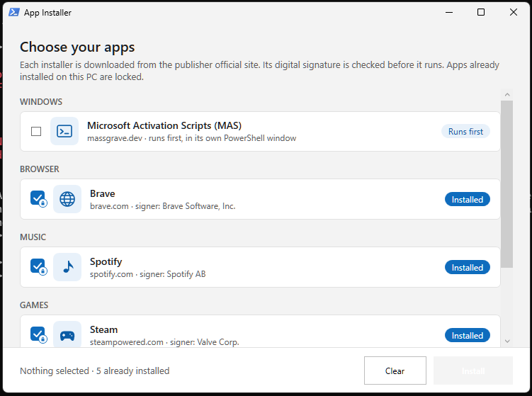

# PCSetter

PCSetter is a Windows app installer that runs without you needing to download anything.</br>Select apps, and it downloads installers from their configured publisher sites, verifies their signatures, and runs them.

<p align="center">
  
</p>

## How to Run it

Open PowerShell ***as administrator*** and run the script from GitHub using the following command:

```powershell
irm 'https://raw.githubusercontent.com/Pereira3/PCSetter/main/PCSetter.ps1' | iex
```


## Use

1. Select the apps to install and press **Install**.
2. Follow progress in PCSetter. Use **Cancel remaining** to stop the queue; an installer already running is not forcibly stopped.
3. When finished, choose **Close** or **Back to installer**.
4. In the **Windows** section, press **Debloat** to review optional removals. Choose items and confirm before anything is uninstalled.

The checklist covers Edge (only where Windows exposes its supported uninstall option), Teams, Clipchamp, the Xbox app, Solitaire, Copilot, the Microsoft 365 app, OneDrive, Tips, Feedback Hub, Phone Link, News, and Weather. Unavailable or uninstalled items are disabled. Edge uninstall is limited to supported regions (including the EEA) and Windows versions, and its standard uninstaller may affect all users. App package removals affect only the current user; provisioned apps for other accounts and other Windows components are not removed. Removing OneDrive stops syncing, so make sure important files are available locally or backed up first. PCSetter does not intentionally delete cloud files.

Microsoft Activation Scripts (MAS) is a third-party project from massgrave.dev that provides scripts for Windows and Office activation. PCSetter runs its hosted script first in an interactive terminal. Use it only in accordance with applicable licensing terms.

## Currently available

| App | Notes |
|---|---|
| Microsoft Activation Scripts (MAS) | Runs first. Its live script is not signature-verified; see the security note below. |
| Brave | Silent install; PCSetter applies its configured Brave policies first. |
| Spotify | Runs as a standard user. |
| Steam | Tries two configured download mirrors. |
| Epic Games Launcher | Silent MSI install. |
| League of Legends | Publisher installer is interactive. |

### Windows Debloat

The **Debloat** section in the Windows app list opens an optional checklist. It can remove Microsoft Edge (only when Windows offers its supported uninstall option), personal Teams, Clipchamp, the Xbox app, Solitaire, Copilot, the Microsoft 365 app, OneDrive, Tips, Feedback Hub, Phone Link, News, and Weather. Nothing is selected automatically; review the list and confirm before removal. Items that are not installed or not supported on your PC are disabled.

Most checklist items are removed only from the current user, not from other Windows accounts. Edge uses Windows' standard uninstaller, may affect all users, and may be relied on by Windows features or other apps; Windows only exposes its uninstall option in supported regions and versions. PCSetter will not force-remove Edge when that option is unavailable.

Removing OneDrive uninstalls its sync app and stops future syncing. Check that important files are available locally or backed up before removal. PCSetter does not intentionally delete cloud files, but removing the client can make synced files less convenient to access.

The checklist avoids removing core Windows components and does not remove provisioned apps for other accounts. Still, removing an app can affect features or workflows that depend on it; leave anything you use installed.

### Brave policies applied by PCSetter

Before installing Brave, PCSetter writes machine-wide policies that disable:

- Brave Rewards, News, and Talk
- Sync
- Wallet and VPN
- AI Chat (Leo)
- Tor windows

These policies apply to all users on the PC. Brave may show a “managed by your organization” notice. To undo them, remove `HKLM:\SOFTWARE\Policies\BraveSoftware\Brave` or use this command in the powershell `Remove-Item -Path "HKLM:\SOFTWARE\Policies\BraveSoftware\Brave" -Recurse`.

## Configuration and logs

The latest run is logged to `%TEMP%\pcsetter.log`. When you elevate using the same Windows account, this is your user temp folder and the log is normally readable after the run. If you enter credentials for a different administrator account, `%TEMP%` may point to that account's folder instead. Downloaded files are kept in a temporary `PCSetter-*` folder during a run and removed afterward.